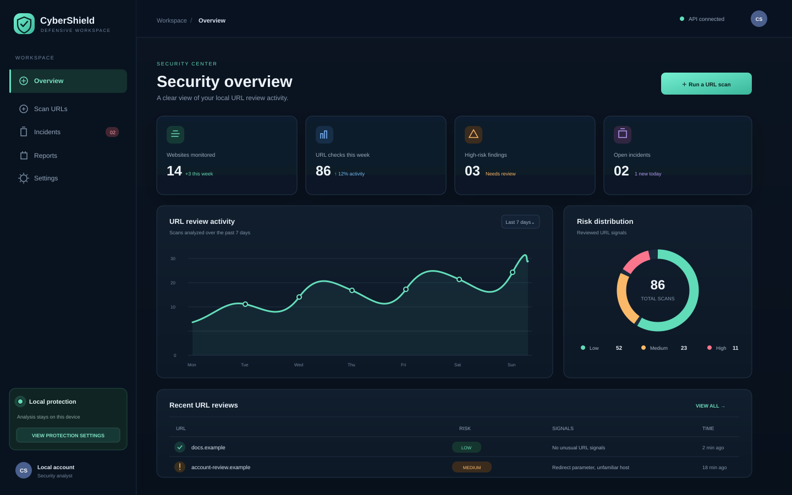
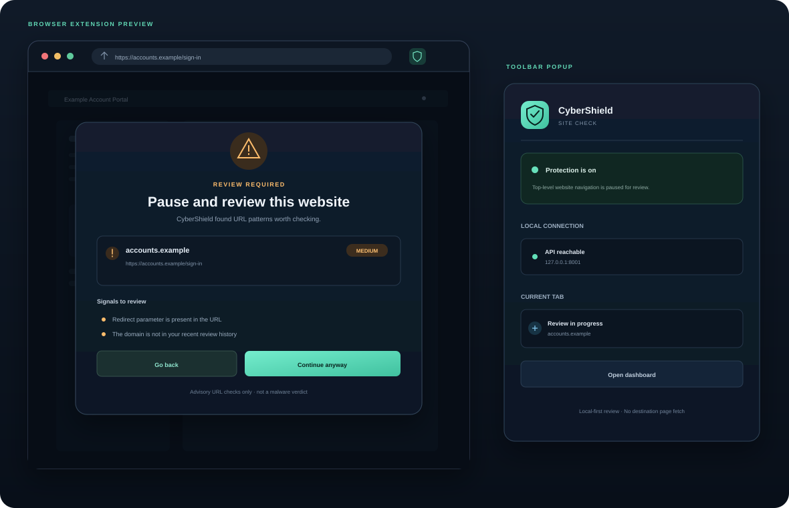

# CyberShield

### Pause. Review. Browse with more confidence.

CyberShield is a local-first tool for reviewing suspicious website URLs. It combines explainable URL checks, a security dashboard, incident tracking, and an optional browser extension that pauses top-level navigation for review.

> **Important:** CyberShield provides advisory URL heuristics. It does not confirm that a website is safe or malicious, and it does not replace browser protection, antivirus software, or professional security services.

<p align="center">
  
</p>
<p align="center"><em>Dashboard preview — illustrative content; a fresh installation has no sample records.</em></p>

## Get started

### Windows — one command

Requirements: Python, Node.js **20.19+ or 22.12+**, and npm installed and available in PowerShell.

1. Open PowerShell in the project folder.
2. Run:

   ```powershell
   .\scripts\start.ps1
   ```

On first run, the script creates a Python virtual environment, installs backend and frontend dependencies, creates `.env` from `.env.example` if needed, and starts the services locally. It may take a few minutes to install dependencies.

Open the dashboard at **[http://127.0.0.1:5173](http://127.0.0.1:5173)** and create an account. The API health check is at [http://127.0.0.1:8001/api/v1/health](http://127.0.0.1:8001/api/v1/health).

To start the services again after setup, run:

```powershell
.\scripts\start-all.ps1
```

### Linux and macOS

Requirements: Python 3, Node.js **20.19+ or 22.12+**, and npm.

In the project root, prepare the environment and start the API:

```bash
cp .env.example .env
sh ./scripts/start.sh
```

In a second terminal, start the dashboard:

```bash
cd frontend
npm ci
npm run dev
```

Open **[http://127.0.0.1:5173](http://127.0.0.1:5173)**.

## What you can do

- **Review URLs:** Get rule-based findings for suspicious URL structure, Unicode/Punycode domains, likely lookalikes, redirect parameters, known shorteners, and risky download suffixes.
- **Understand findings:** Review the evidence behind the advisory risk assessment rather than relying on an unexplained verdict.
- **Track incidents:** View user-scoped scan history, manage incidents, and add investigation notes.
- **Use the dashboard:** See summaries and export reports in CSV, XLSX, PDF, or HTML.
- **Review browser navigation:** Optionally load the extension in Chrome, Edge, or Brave to pause top-level HTTP/HTTPS navigation before deciding whether to continue.
- **Keep analysis local:** Optionally connect a local Ollama installation for an additional AI advisory. Deterministic URL rules remain the source of recorded risk scores.

## Browser extension

<p align="center">
  
</p>
<p align="center"><em>Extension preview — illustrative UI, not a live browser screenshot.</em></p>

1. Start CyberShield and create an account in the dashboard.
2. In Chrome, Edge, or Brave, open the browser's extensions page and enable **Developer mode**.
3. Select **Load unpacked** and choose this project's `extension/` folder.
4. Open the extension settings. Set the API URL to `http://127.0.0.1:8001/api/v1` and provide a session token from the dashboard settings.
5. Visit a website to see the review screen.

The extension needs broad HTTP/HTTPS navigation access to pause top-level navigation. Review its permissions before enabling it. It can be disabled or removed from the browser's extensions page.

## How it works — and what it does not do

CyberShield analyzes URL strings with deterministic, explainable rules. The optional local assistant can add context, but its output is advisory and does not determine the recorded rule-based score.

- The API does **not** fetch destination pages, resolve DNS, probe ports, or download files.
- The extension does **not** inspect page bodies, iframe requests, or downloaded-file contents.
- The extension may collect limited page metadata, such as the page title and security-related counters. It does not read page body text, cookies, or tokens.
- Heuristics can produce false positives or miss threats. Always use your judgment and trusted security tools.
- This project is designed for local development, not as a production security service.

## Configuration and data

Copy `.env.example` to `.env` to review local settings. The Windows startup script creates this file if it is missing. `.env` may contain local secrets and should not be committed.

| Setting | Default | Purpose |
|---|---|---|
| `API_HOST` | `127.0.0.1` | API bind address |
| `API_PORT` | `8001` | API port |
| `DATABASE_URL` | `sqlite:///./backend/cybershield.db` | Local database |
| `SESSION_TTL_HOURS` | `24` | Session lifetime |
| `OLLAMA_BASE_URL` | `http://127.0.0.1:11434` | Optional local Ollama endpoint |
| `OLLAMA_MODEL` | `llama3.1:8b` | Optional Ollama model |

SQLite creates the database on first startup. New databases have no seeded accounts or demo records. See [docs/DATA_MODEL.md](docs/DATA_MODEL.md) for the schema.

## Project map

```text
backend/       FastAPI API, authentication, URL analysis, and persistence
docs/          API, architecture, feature boundaries, and data model
extension/     Manifest V3 browser extension
frontend/      React, TypeScript, and Vite dashboard
scripts/       Local startup and extension asset helpers
```

## Documentation

- [API reference](docs/API.md) — endpoints and authentication
- [Architecture](docs/ARCHITECTURE.md) — components and data flow
- [Feature status and boundaries](docs/FEATURES.md) — implemented behavior and limitations
- [Data model](docs/DATA_MODEL.md) — stored entities
- [Security policy](SECURITY.md) — private vulnerability reporting

## Security

Keep the API bound to loopback for local use. Do not expose it to a network without a separate deployment and security review. Never commit `.env` files, passwords, tokens, or other secrets. To report a vulnerability, use **Security → Report a vulnerability** on GitHub rather than opening a public issue.

## Contributing

Bug reports, thoughtful feature ideas, documentation improvements, and pull requests are welcome. Please keep contributions consistent with the project's local-first design and clearly document any new data collection or external service.

## License

CyberShield is distributed under the [MIT License](LICENSE).
